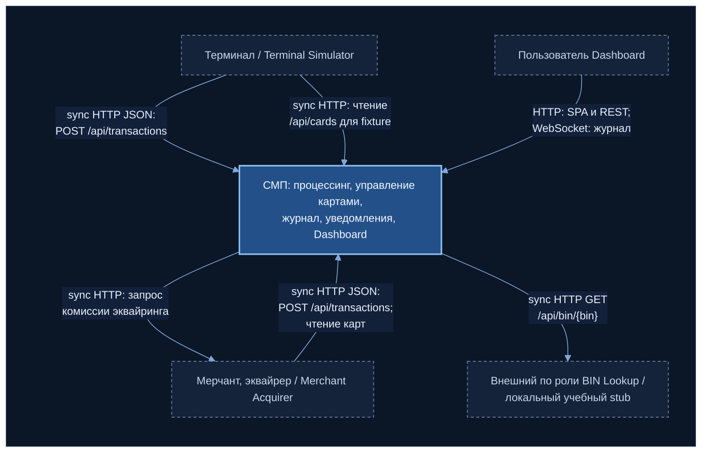

# А1. C4 Level 1 — Context

> Уровень C4: **System Context**. СМП нарисована одним блоком; показано, кто находится снаружи,
> в каком направлении идёт вызов и по какому протоколу.
> Источник истины — код в [`services/`](../../../services/) и [`docker-compose.yaml`](../../../docker-compose.yaml).

## Описание

### Граница системы

Внутри блока «СМП» находятся контейнеры, которые обрабатывают и хранят платёжные данные:
Gateway, Switch, Authorization, Card Management, Transaction Logger, Notification Service,
backend Dashboard (nginx + SPA), PostgreSQL и RabbitMQ. Их внутреннее устройство раскрыто на
[А2](a2-container.md).

Снаружи находятся четыре актора. Terminal Simulator и Merchant Acquirer лежат в том же
репозитории, но по роли это **эмуляторы внешних участников** платёжной цепочки (терминал и
эквайрер), а не часть процессинга. BIN Lookup в стенде тоже локальный сервис, но по роли это
внешний справочник BIN, отказ которого СМП обязана переживать.

### Акторы и протоколы входа

| Актор | Направление | Протокол и точка входа | Что это значит |
|---|---|---|---|
| Terminal Simulator | → СМП | sync HTTP JSON, `POST /api/transactions` на Gateway | Основной вход авторизации (MTI 0100). Ответ (0110) приходит в том же HTTP-вызове |
| Terminal Simulator | → СМП | sync HTTP, `GET /api/cards?status=…&limit=…` | Симулятор сам подбирает карты под сценарий (normal, blocked, no money и т.д.). Запрос идёт **напрямую в Card Management**, минуя Gateway |
| Merchant Acquirer | → СМП | sync HTTP JSON, `POST /api/transactions` и `GET /api/cards` через Gateway | Второй источник транзакций, у него собственная база мерчантов и терминалов |
| СМП → Merchant Acquirer | ← из СМП | sync HTTP, `POST /api/simulator/merchant/fee` | Обратная связь: Switch во время обработки транзакции запрашивает у эквайрера комиссию. При ошибке комиссия = `null`, транзакция не прерывается |
| Пользователь Dashboard | → СМП | HTTP (SPA и REST `/api/*` через nginx → Gateway) + WebSocket `/ws/transactions` (nginx → Logger) | REST — чтение статистики и журнала по запросу; WebSocket — push новых транзакций после их сохранения в Logger |
| BIN Lookup | ← из СМП | sync HTTP, `GET /api/bin/{bin}` | Authorization обогащает запрос `issuerId`. Любая ошибка даёт `Optional.empty()`: graceful degradation, авторизация продолжается |

### Как читать стрелки

Все связи на уровне Context — **синхронные HTTP**: вызывающий ждёт ответа. Асинхронные
связи (AMQP) существуют только внутри СМП и появляются на [А2](a2-container.md).
Единственный канал с push-доставкой наружу — WebSocket к Dashboard: данные в нём появляются
**после** асинхронной записи в журнал, то есть с задержкой (eventual consistency).

## Чего не хватало в проекте

- Отдельной Context-диаграммы нет. Общая схема в [`docs/architecture.md`](../../architecture.md)
  (`graph TB`) смешивает внешних акторов и внутренние контейнеры на одном рисунке; граница
  «СМП vs внешний мир» не проведена.
- Не указаны протоколы входа для пользователя Dashboard (REST + WebSocket через nginx).
- Не отражены две связи, которые есть в коде:
  - Terminal Simulator читает карты из Card Management **напрямую**, а не через Gateway;
  - Switch **сам вызывает** Merchant Acquirer за комиссией (направление СМП → актор).
- BIN Lookup показан как обычный сервис, без пометки, что это внешний справочник с graceful degradation.

## Что сделано

- Проведена граница системы; эмуляторы и BIN Lookup вынесены наружу по их роли.
- Для каждой связи указаны направление, синхронность и конкретный endpoint.
- Добавлены две связи из кода, отсутствующие в документации (Terminal → CMS, Switch → Merchant fee).
- Каждая стрелка подтверждена ссылкой на код (таблица ниже).

## Для чего нужно в тестировании

Карта границ для E2E (модуль 7): Terminal и Merchant Simulator — это драйверы тестов
(их эмулируем или заменяем тестовым клиентом); BIN Lookup можно заглушить или выключить,
потому что его отказ не должен ломать авторизацию; Dashboard для backend-E2E не нужен,
достаточно проверить журнал через REST.

## Источники истины

| Утверждение | Код / конфигурация |
|---|---|
| Terminal → Gateway `POST /api/transactions` | [terminal-simulator `GatewayClient.java#L30`](../../../services/terminal-simulator/src/main/java/com/processing/terminalsimulator/client/GatewayClient.java#L30) |
| Terminal → CMS `GET /api/cards` напрямую | [`GatewayClient.java#L34`](../../../services/terminal-simulator/src/main/java/com/processing/terminalsimulator/client/GatewayClient.java#L34), [`application.yml#L6`](../../../services/terminal-simulator/src/main/resources/application.yml#L6), [`docker-compose.yaml#L243`](../../../docker-compose.yaml#L243) (`CARD_MGMT_URL=http://card-management:8080`) |
| Merchant → Gateway: карты и транзакции | [merchant-acquirer `GatewayClient.java#L56`](../../../services/merchant-acquirer/src/main/java/com/processing/merchantacquirer/client/GatewayClient.java#L56), [`#L92`](../../../services/merchant-acquirer/src/main/java/com/processing/merchantacquirer/client/GatewayClient.java#L92) |
| Switch → Merchant `POST /api/simulator/merchant/fee`, `null` при ошибке | [`MerchantAcquirerClient.java#L47`](../../../services/switch/src/main/java/com/processing/service/MerchantAcquirerClient.java#L47), [`#L59`](../../../services/switch/src/main/java/com/processing/service/MerchantAcquirerClient.java#L59); endpoint [`SimulationController.java#L121`](../../../services/merchant-acquirer/src/main/java/com/processing/merchantacquirer/controller/SimulationController.java#L121) |
| Dashboard: `/api/` → Gateway, `/ws/` → Logger | [`dashboard/nginx.conf#L22`](../../../services/dashboard/nginx.conf#L22), [`#L29`](../../../services/dashboard/nginx.conf#L29); [`useWebSocket.ts#L19`](../../../services/dashboard/src/hooks/useWebSocket.ts#L19) |
| WebSocket `/ws/transactions` в Logger | [`WebSocketConfig.java#L31`](../../../services/transaction-logger/src/main/java/com/processing/transactionlogger/websocket/WebSocketConfig.java#L31) |
| Authorization → BIN Lookup `GET /api/bin/{bin}` | [`BinLookupClient.java#L59`](../../../services/authorization/src/main/java/com/processing/authorization/client/BinLookupClient.java#L59) |
| Ошибка BIN Lookup → `Optional.empty()` | [`BinLookupClient.java#L65`](../../../services/authorization/src/main/java/com/processing/authorization/client/BinLookupClient.java#L65) |
| BIN Lookup — локальный stub | [`BinLookupController.java#L38`](../../../services/bin-lookup/src/main/java/com/processing/binlookup/controller/BinLookupController.java#L38) |
| Маршруты Gateway (`/api/transactions`, `/api/cards/**`, `/api/simulator/**`) | [`gateway application.yml#L64`](../../../services/gateway/src/main/resources/application.yml#L64) |
