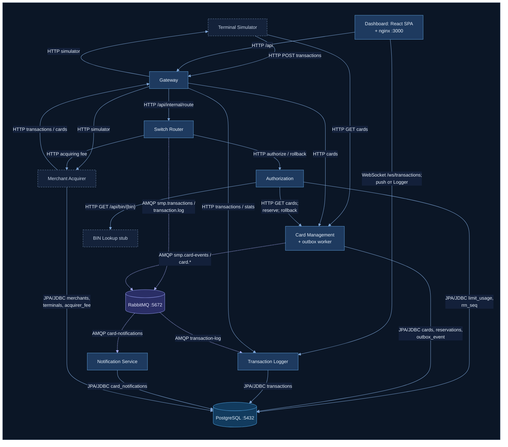

# А2. C4 Level 2 — Container

> Уровень C4: **Container**. Раскрыт блок «СМП» из [А1](a1-context.md): все прикладные
> контейнеры из `docker-compose.yaml`, PostgreSQL и RabbitMQ, с разметкой синхронных и
> асинхронных связей.
> Источник истины — [`docker-compose.yaml`](../../../docker-compose.yaml) и HTTP/AMQP-клиенты в [`services/`](../../../services/).

## Легенда

| Линия | Значение | Как тестируется |
|---|---|---|
| сплошная `-->` | **sync**: HTTP request/response или JDBC. Вызывающий ждёт результат в том же потоке | API-тест (контракт: статус, тело) или integration с БД |
| пунктир `-.->` | **async**: публикация в RabbitMQ (AMQP). Отправитель не ждёт обработки потребителем | integration-тест с брокером: сообщение ушло → потребитель получил → БД изменилась; ожидание через polling |
| WebSocket | долгоживущее соединение, сервер сам присылает данные (push) | не AMQP, поэтому нарисован сплошным; данные в нём появляются после асинхронной записи в журнал |

Цвета (ночная тема, общие для А1–А5): тёмно-синяя подложка — граница рисунка; тёмный блок с пунктирной
серо-голубой рамкой — внешние акторы и BIN Lookup; синий блок с голубой рамкой — контейнеры и компоненты СМП;
синий цилиндр — PostgreSQL; фиолетово-синий — RabbitMQ, exchange/очереди и AMQP-стрелки; пунктирный
фиолетовый — DLX/DLQ.

## Описание

### Состав контейнеров и сверка с docker-compose

В `docker-compose.yaml` 10 прикладных контейнеров + PostgreSQL + RabbitMQ — все они есть на
диаграмме. «11 сервисов» из задания соответствует health-check в
[`scripts/smoke-test.sh`](../../../scripts/smoke-test.sh#L48): 9 Java-сервисов + Dashboard + RabbitMQ Management UI.
Стек наблюдаемости (prometheus, grafana, loki, promtail, autoscaler с профилем
`observability`) в обработку транзакций не входит и на диаграмму не вынесен.

| Контейнер | Сервис в compose | Порт хоста → контейнера | Исходящие зависимости (env) |
|---|---|---|---|
| Gateway | `gateway` | 8080 → 8080 | `SWITCH_URL`, `CARD_MGMT_URL`, `LOGGER_URL`, `TERMINAL_SIM_URL`, `MERCHANT_SIM_URL`, `AUTH_URL` (только health) |
| Switch Router | `switch` | 8082 → 8080 | `AUTH_URL`, `MERCHANT_URL`, RabbitMQ |
| Authorization | `authorization` | 8083 → 8080 | `CARD_MGMT_URL`, `BIN_LOOKUP_URL`, PostgreSQL |
| Card Management | `card-management` | 8081 → 8080 | PostgreSQL, RabbitMQ |
| BIN Lookup | `bin-lookup` | 8096 → 8080 | — |
| Transaction Logger | `transaction-logger` | 8088 → 8080 | PostgreSQL, RabbitMQ |
| Notification Service | `notification-service` | 8097 → 8080 | PostgreSQL, RabbitMQ |
| Terminal Simulator | `terminal-simulator` | 8085 → 8080 | `GATEWAY_URL`, `CARD_MGMT_URL` |
| Merchant Acquirer | `merchant-acquirer` | 8084 → 8080 | `GATEWAY_URL`, PostgreSQL |
| Dashboard | `dashboard` | 3000 → 3000 | `GATEWAY_URL`, `LOGGER_WS_URL` |
| PostgreSQL | `postgres` | 5432 → 5432 | одна база `smp_db`, у каждого сервиса свои таблицы |
| RabbitMQ | `rabbitmq` | 5672, 15672 (UI) | — |

### Синхронные связи (HTTP)

| Откуда → куда | Endpoint | Особенность |
|---|---|---|
| Gateway → Switch | `POST /api/transactions` → rewrite в `/api/internal/route` | Перед проксированием `TransactionValidationFilter` валидирует запрос; невалидный не доходит до Switch (400) |
| Gateway → CMS / Logger / симуляторы | `/api/cards/**`, `/api/transactions/**`, `/api/dashboard/**`, `/api/simulator/**` | Чистое проксирование по маршрутам Spring Cloud Gateway |
| Switch → Authorization | `POST /api/internal/authorize`, `POST /api/internal/rollback` | Authorize обёрнут в retry (3 попытки) и circuit breaker. Не-2xx ответ не считается ошибкой: тело DECLINED разбирается |
| Switch → Merchant Acquirer | `POST /api/simulator/merchant/fee` | Ошибка → комиссия `null`, транзакция продолжается |
| Authorization → CMS | `GET /api/cards/{pan}`, `POST /api/cards/{pan}/reserve`, `POST /api/cards/{pan}/rollback` | Вызовы через `RestClient`; ошибки CMS превращаются в коды отказа |
| Authorization → BIN Lookup | `GET /api/bin/{bin}` | Graceful degradation: ошибка → `Optional.empty()` |
| Switch → Gateway | ответ всегда **HTTP 200** | Бизнес-результат (APPROVED/DECLINED, код) — в теле ответа |

### Асинхронные связи (AMQP)

| Producer | Exchange / routing key | Очередь | Consumer |
|---|---|---|---|
| Switch (`LoggerClient`) | `smp.transactions` (topic) / `transaction.log` | `transaction-log` | Transaction Logger (`TransactionLogListener`) |
| Card Management (outbox worker) | `smp.card-events` (topic) / `card.<ИмяСобытия>` | `card-notifications` (binding `card.*`) | Notification Service (`CardEventListener`) |

Обе асинхронные связи — **после** синхронной части: клиент получает ответ раньше, чем запись
появляется в журнале или в уведомлениях. Подробная топология с DLX/DLQ — [А5](a5-rabbitmq-topology.md).

### Хранение (JDBC)

Пять сервисов работают с одной базой `smp_db`, но каждый — только со своими таблицами:
Authorization — `limit_usage` и последовательность `rrn_seq`; Card Management — `cards`,
`reservations`, `reservation_rollbacks`, `bin_issuers`, `outbox_event`; Logger — `transactions`;
Notification — `card_notifications`; Merchant Acquirer — `merchants`, `terminals`, `acquirer_fee`.
Межсервисных JOIN нет: данные других сервисов читаются только через HTTP.

## Чего не хватало в проекте

- [`architecture-diagram.puml`](../../architecture-diagram.puml) и mermaid-схема в
  [`architecture.md`](../../architecture.md) **не различают sync и async**: публикация в RabbitMQ
  нарисована той же стрелкой, что и HTTP-вызов. (Единственная пунктирная линия в puml — WebSocket.)
- Связи без подписей протокола и endpoint (`GW --> SW`, `SW --> AUTH`, `AUTH --> CMS`).
- Схема не сверена с compose. Отсутствуют связи, которые есть в коде и env:
  Gateway → CMS / Logger / симуляторы (маршруты), Terminal → CMS, Switch → Merchant fee,
  Merchant Acquirer → PostgreSQL, Switch → Authorization rollback.
- Не показано, что Card Management публикует события **через outbox-worker**, а не напрямую.
- Нет имён exchange / routing key / очередей на стрелках.

## Что сделано

- Каждая связь размечена: сплошная — HTTP/JDBC, пунктир — AMQP; на AMQP-стрелках указаны exchange, routing key и очередь.
- Состав контейнеров и связи сверены с `docker-compose.yaml` (сервисы, env-URL, порты) и маршрутами Gateway.
- Добавлены отсутствовавшие связи; для БД указаны таблицы каждого сервиса.

## Для чего нужно в тестировании

Каждая стрелка — точка сочленения и кандидат на тест. Сплошные стрелки — контракты для
API-тестов (модуль 5). Пунктирные — кандидаты на integration-тесты с реальным брокером
(модуль 6), где проверяется доставка и eventual consistency, а не ответ на запрос.

## Источники истины

| Утверждение | Код / конфигурация |
|---|---|
| Состав сервисов, порты, env-URL | [`docker-compose.yaml`](../../../docker-compose.yaml), порты в [`.env.example`](../../../.env.example) |
| Маршруты Gateway | [`gateway application.yml#L64`](../../../services/gateway/src/main/resources/application.yml#L64) |
| Валидация на Gateway | [`TransactionValidationFilter.java`](../../../services/gateway/src/main/java/com/processing/gateway/validation/TransactionValidationFilter.java), [`TransactionRequestValidator.java`](../../../services/gateway/src/main/java/com/processing/gateway/validation/TransactionRequestValidator.java) |
| Switch: вход `/api/internal/route`, всегда HTTP 200 | [`RouteController.java#L44`](../../../services/switch/src/main/java/com/processing/controller/RouteController.java#L44), [`#L49`](../../../services/switch/src/main/java/com/processing/controller/RouteController.java#L49) |
| Switch → Authorization authorize/rollback, retry 3 | [`AuthorizationClient.java#L81`](../../../services/switch/src/main/java/com/processing/service/AuthorizationClient.java#L81), [`#L100`](../../../services/switch/src/main/java/com/processing/service/AuthorizationClient.java#L100), [`switch application.yml#L24`](../../../services/switch/src/main/resources/application.yml#L24) |
| Switch → Merchant fee | [`MerchantAcquirerClient.java#L47`](../../../services/switch/src/main/java/com/processing/service/MerchantAcquirerClient.java#L47) |
| Switch → RabbitMQ | [`LoggerClient.java#L40`](../../../services/switch/src/main/java/com/processing/service/LoggerClient.java#L40), [`RabbitMQConfig.java#L22`](../../../services/switch/src/main/java/com/processing/config/RabbitMQConfig.java#L22) |
| Authorization → CMS (get / reserve / rollback) | [`CardManagementClientImpl.java#L36`](../../../services/authorization/src/main/java/com/processing/authorization/client/CardManagementClientImpl.java#L36), [`#L70`](../../../services/authorization/src/main/java/com/processing/authorization/client/CardManagementClientImpl.java#L70), [`#L105`](../../../services/authorization/src/main/java/com/processing/authorization/client/CardManagementClientImpl.java#L105) |
| Authorization → BIN Lookup | [`BinLookupClient.java#L59`](../../../services/authorization/src/main/java/com/processing/authorization/client/BinLookupClient.java#L59) |
| CMS → RabbitMQ через outbox | [`OutboxEventProcessorImpl.java#L35`](../../../services/card-management/src/main/java/com/processing/cardmanagement/services/OutboxEventProcessorImpl.java#L35), [`RabbitMQConfig.java#L27`](../../../services/card-management/src/main/java/com/processing/cardmanagement/config/RabbitMQConfig.java#L27) |
| Logger ← RabbitMQ | [`TransactionLogListener.java#L27`](../../../services/transaction-logger/src/main/java/com/processing/transactionlogger/listener/TransactionLogListener.java#L27) |
| Notification ← RabbitMQ | [`CardEventListener.java#L36`](../../../services/notification-service/src/main/java/com/processing/notification/listener/CardEventListener.java#L36) |
| Таблицы | [`LimitUsage.java#L34`](../../../services/authorization/src/main/java/com/processing/authorization/entities/LimitUsage.java#L34), [`CardEntity.java`](../../../services/card-management/src/main/java/com/processing/cardmanagement/models/CardEntity.java), [`ReservationEntity.java#L15`](../../../services/card-management/src/main/java/com/processing/cardmanagement/models/ReservationEntity.java#L15), [`CardOutboxEventDataEntity.java#L12`](../../../services/card-management/src/main/java/com/processing/cardmanagement/models/CardOutboxEventDataEntity.java#L12), [`Transaction.java#L23`](../../../services/transaction-logger/src/main/java/com/processing/transactionlogger/model/Transaction.java#L23), [`CardNotification.java#L25`](../../../services/notification-service/src/main/java/com/processing/notification/model/CardNotification.java#L25), [merchant-acquirer migrations](../../../services/merchant-acquirer/src/main/resources/db/migration/) |
| WebSocket и nginx Dashboard | [`WebSocketConfig.java#L31`](../../../services/transaction-logger/src/main/java/com/processing/transactionlogger/websocket/WebSocketConfig.java#L31), [`nginx.conf#L22`](../../../services/dashboard/nginx.conf#L22) |
