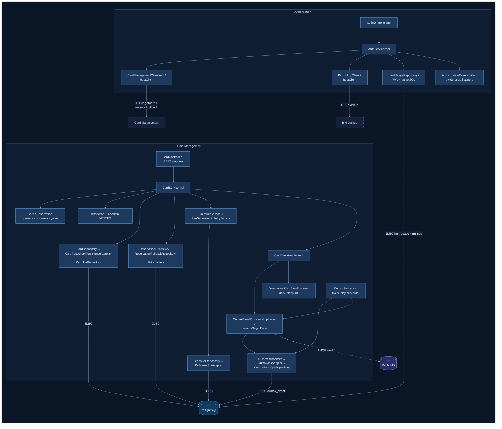

# А3. C4 Level 3 — Component (Authorization, Card Management)

> Уровень C4: **Component**. Внутреннее устройство двух ключевых сервисов: controller → service →
> client / repository, где HTTP-клиенты, где JDBC и где outbox-публикация.
> Источник истины — пакеты [`services/authorization/…`](../../../services/authorization/src/main/java/com/processing/authorization/)
> и [`services/card-management/…`](../../../services/card-management/src/main/java/com/processing/cardmanagement/).

Легенда: сплошная линия — синхронный вызов (Java-вызов внутри сервиса, HTTP или JDBC наружу);
пунктир — асинхронная публикация в RabbitMQ.

## Описание: Authorization

| Компонент | Ответственность | Тип зависимости |
|---|---|---|
| `AuthControllerImpl` | REST `POST /api/internal/authorize` и `/rollback`, `@Valid` на теле. Переводит `declineReason` в HTTP-статус: BLOCKED/INACTIVE/EXPIRED → 403, CARD_NOT_FOUND → 404, INSUFFICIENT_FUNDS → 422, SERVICE_UNAVAILABLE/RESERVATION_FAILED → 503, прочее → 400 | вход HTTP |
| `AuthServiceImpl` | Вся бизнес-логика авторизации, метод `authorize()` под `@Transactional`. Порядок проверок: получить карту → BIN lookup → статус → срок (UTC-дата запроса vs конец месяца expiry) → баланс → лимиты (SQL upsert) → RRN → reserve в CMS. Каждая ветка отказа — константа `DeclineOutcome` с ISO-кодом | чистая логика + оркестрация |
| `CardManagementClientImpl` | HTTP-клиент к CMS: `GET /api/cards/{pan}`, `POST …/reserve`, `POST …/rollback`. Ответы CMS переводит в исключения (`CardNotFoundException`, `ServiceUnavailableException`, `InsufficientFundsException` …) | HTTP sync |
| `BinLookupClient` | HTTP-клиент к BIN Lookup. Любая ошибка → `Optional.empty()`, на решение не влияет | HTTP sync, graceful degradation |
| `LimitUsageRepository` | Native SQL `INSERT … ON CONFLICT DO UPDATE … WHERE` — проверка дневного и месячного лимита и накопление usage **одним атомарным запросом** (0 строк = лимит превышен). Плюс `fetchRrnBlock()` из `rrn_seq` для генерации RRN блоками по 1000 | JDBC |
| `AuthorizationEventNotifier` | Рассылает события авторизации локальным listener'ам (`AuthorizationLogEventListenerImpl` пишет логи). Не брокер: вызов синхронный, внутри процесса | in-process |

Важные для тестирования детали:
- Решение о лимите принимается **в SQL**, а не в Java: mock репозитория не проверит границу лимита — нужна реальная PostgreSQL.
- Ошибка `reserve` перехватывается и возвращается как DECLINED, исключение из `authorize()` не выходит,
  поэтому транзакция Authorization **коммитится** вместе с уже увеличенным usage.
  Вложенный `@Transactional` на `checkAndUpdateLimits` не действует (вызов через `this`, без прокси).

## Описание: Card Management

| Компонент | Ответственность | Тип зависимости |
|---|---|---|
| `CardController` + `CardRestMapper`, `CardStatusMapper` | REST `/api/cards`: создание, чтение, фильтр с пагинацией (default `limit=10`), PATCH, DELETE, `reserve`, `rollback`, `bulk-update`. Маппинг DTO ↔ домен; статус `DELETED` наружу не отдаётся | вход HTTP |
| `CardServiceImpl` | Сценарии над картой. Каждая изменяющая операция выполняется внутри `TransactionRunner` и заканчивается вызовом `eventNotifier` | оркестрация |
| `Card`, `Reservation` (домен) | Правила состояния и денег: резерв только для ACTIVE (`checkStatusOrThrow`), проверка баланса, повторный rollback запрещён (`RollbackAlreadySatisfiedException`), soft delete | чистая логика (unit) |
| `TransactionRunnerImpl` | `@Transactional(propagation = NESTED)`: изменение карты/резерва и запись outbox-события идут **в одной транзакции БД** | транзакционная граница |
| `CardRepository`, `ReservationRepository`, `ReservationRollbackRepository`, `BinIssuerRepository` → `*Adapter` → `*JpaRepository` | Порты и адаптеры: сервис зависит от интерфейса, адаптер переводит домен ↔ JPA-сущность. `getCardForUpdate` берёт строку с блокировкой | JDBC |
| `BinIssuerService` + `PanGenerator` + `RetryService` | Создание карты: issuerId по BIN, генерация PAN с контрольной цифрой Луна, повтор создания при ошибке (например, коллизия PAN) не более `maxCardCreationRetries` раз | логика + JDBC |
| `CardEventNotifierImpl` | Маршрутизирует событие **либо** в outbox (все `CardOutboxEvent`: создание, PATCH, удаление, reserve, rollback, генерация), **либо** локальным listener'ам (только `CardsAmountUpdatedEvent`) | in-process |
| `OutboxEventProcessorImpl` | `save()` — запись события в `outbox_event` (PENDING) в транзакции бизнес-операции. `processSingleEvent()` — `convertAndSend` в `smp.card-events` с routing key `card.<ИмяКлассаСобытия>` → PROCESSED; при исключении `retryCount+1`, на 3-й ошибке FAILED | JDBC + AMQP |
| `OutboxProcessor` | `@Scheduled(fixedDelay = 1000 ms)`, `@Transactional`: выбирает PENDING с `retryCount < 3` и передаёт их в `processSingleEvent` | планировщик |

Важные для тестирования детали:
- Публикация события отделена от бизнес-операции: PATCH возвращает ответ сразу, а сообщение уходит
  в RabbitMQ в следующем тике планировщика. Это outbox-паттерн: событие не теряется при недоступном брокере.
- Локальные listener'ы (`CardServiceLogEventListener`, `CardMetricsEventListener`) содержат ветки для
  событий создания/удаления, но по коду `CardEventNotifierImpl` такие события уходят **только** в outbox —
  до listener'ов доходит лишь `CardsAmountUpdatedEvent`. Наблюдение из кода; кандидат на проверку.
- На диаграмму не вынесены компоненты вне пути транзакции: `CardGeneratorController/Service`,
  `BinIssuerController`, health- и metrics-компоненты.

## Чего не хватало в проекте

Компонентного уровня в документации нет совсем: [`architecture.md`](../../architecture.md) и
[`architecture-diagram.puml`](../../architecture-diagram.puml) заканчиваются на уровне контейнеров.
Не видно, где в сервисе чистая логика, где HTTP-клиенты, где SQL и что публикация событий
CMS — отдельный компонент со своим планировщиком.

## Что сделано

- Диаграмма построена с нуля по пакетам `controller / services / client / repositories / events / models`.
- Для каждого компонента указан тип зависимости: логика, HTTP, JDBC, AMQP, in-process.
- Показаны транзакционная граница CMS (NESTED) и путь outbox: notifier → `outbox_event` → scheduler → RabbitMQ.

## Для чего нужно в тестировании

Карта для unit-тестов (модуль 4) и выбора тестовых двойников:
- **unit** — `AuthServiceImpl` (моки `CardManagementClient`, `BinLookupClient`, `LimitUsageRepository`),
  доменные `Card` / `Reservation`, `OutboxEventProcessorImpl` (mock `RabbitTemplate`), `RoutingService` в Switch;
- **api** — контроллеры с замоканным сервисом (маппинг статусов, валидация);
- **integration** — `LimitUsageRepository` (native SQL), репозитории CMS с блокировками,
  атомарность «изменение + outbox» и outbox → RabbitMQ.

## Источники истины

| Утверждение | Код |
|---|---|
| Controller и маппинг HTTP-статусов | [`AuthControllerImpl.java#L38`](../../../services/authorization/src/main/java/com/processing/authorization/controller/AuthControllerImpl.java#L38), [`#L82`](../../../services/authorization/src/main/java/com/processing/authorization/controller/AuthControllerImpl.java#L82) |
| `authorize()` под `@Transactional`, порядок проверок | [`AuthServiceImpl.java#L42`](../../../services/authorization/src/main/java/com/processing/authorization/services/AuthServiceImpl.java#L42), getCard [`#L46`](../../../services/authorization/src/main/java/com/processing/authorization/services/AuthServiceImpl.java#L46), BIN [`#L66`](../../../services/authorization/src/main/java/com/processing/authorization/services/AuthServiceImpl.java#L66), срок [`#L107`](../../../services/authorization/src/main/java/com/processing/authorization/services/AuthServiceImpl.java#L107), баланс [`#L114`](../../../services/authorization/src/main/java/com/processing/authorization/services/AuthServiceImpl.java#L114), лимиты [`#L125`](../../../services/authorization/src/main/java/com/processing/authorization/services/AuthServiceImpl.java#L125), RRN [`#L149`](../../../services/authorization/src/main/java/com/processing/authorization/services/AuthServiceImpl.java#L149), reserve [`#L151`](../../../services/authorization/src/main/java/com/processing/authorization/services/AuthServiceImpl.java#L151) |
| Коды отказа | [`DeclineOutcome.java`](../../../services/authorization/src/main/java/com/processing/authorization/constants/DeclineOutcome.java) |
| HTTP-клиенты | [`CardManagementClientImpl.java#L36`](../../../services/authorization/src/main/java/com/processing/authorization/client/CardManagementClientImpl.java#L36), [`BinLookupClient.java#L59`](../../../services/authorization/src/main/java/com/processing/authorization/client/BinLookupClient.java#L59) |
| Native SQL лимитов и `rrn_seq` | [`LimitUsageRepository.java#L63`](../../../services/authorization/src/main/java/com/processing/authorization/repositories/LimitUsageRepository.java#L63), [`#L118`](../../../services/authorization/src/main/java/com/processing/authorization/repositories/LimitUsageRepository.java#L118) |
| Локальные события Authorization | [`AuthorizationEventNotifierImpl.java#L13`](../../../services/authorization/src/main/java/com/processing/authorization/events/AuthorizationEventNotifierImpl.java#L13), [`AuthorizationLogEventListenerImpl.java`](../../../services/authorization/src/main/java/com/processing/authorization/listeners/AuthorizationLogEventListenerImpl.java) |
| REST CMS | [`CardController.java`](../../../services/card-management/src/main/java/com/processing/cardmanagement/controllers/CardController.java), [`CardRestMapper.java`](../../../services/card-management/src/main/java/com/processing/cardmanagement/mappers/CardRestMapper.java), [`CardStatusMapper.java#L12`](../../../services/card-management/src/main/java/com/processing/cardmanagement/mappers/CardStatusMapper.java#L12) |
| Сервис и его зависимости | [`CardServiceImpl.java#L36`](../../../services/card-management/src/main/java/com/processing/cardmanagement/services/CardServiceImpl.java#L36) |
| Доменные правила | [`Card.java#L102`](../../../services/card-management/src/main/java/com/processing/cardmanagement/models/Card.java#L102), [`#L261`](../../../services/card-management/src/main/java/com/processing/cardmanagement/models/Card.java#L261), [`Reservation.java#L50`](../../../services/card-management/src/main/java/com/processing/cardmanagement/models/Reservation.java#L50) |
| NESTED-транзакция | [`TransactionRunnerImpl.java#L11`](../../../services/card-management/src/main/java/com/processing/cardmanagement/services/TransactionRunnerImpl.java#L11) |
| Адаптеры репозиториев | [`CardRepositoryPersistenceAdapter.java`](../../../services/card-management/src/main/java/com/processing/cardmanagement/repositories/CardRepositoryPersistenceAdapter.java), [`ReservationRepositoryPersistenceAdapter.java`](../../../services/card-management/src/main/java/com/processing/cardmanagement/repositories/ReservationRepositoryPersistenceAdapter.java), [`BinIssuerJpaAdapter.java`](../../../services/card-management/src/main/java/com/processing/cardmanagement/repositories/BinIssuerJpaAdapter.java), [`OutboxJpaAdapter.java#L35`](../../../services/card-management/src/main/java/com/processing/cardmanagement/repositories/OutboxJpaAdapter.java#L35) |
| Создание карты | [`BinIssuerService.java`](../../../services/card-management/src/main/java/com/processing/cardmanagement/services/BinIssuerService.java), [`PanGenerator.java`](../../../services/card-management/src/main/java/com/processing/cardmanagement/services/PanGenerator.java), [`RetryService.java`](../../../services/card-management/src/main/java/com/processing/cardmanagement/services/retries/RetryService.java) |
| Маршрутизация событий: outbox или listeners | [`CardEventNotifierImpl.java#L16`](../../../services/card-management/src/main/java/com/processing/cardmanagement/events/CardEventNotifierImpl.java#L16), [`CardEvent.java#L3`](../../../services/card-management/src/main/java/com/processing/cardmanagement/events/CardEvent.java#L3) |
| Outbox: публикация, retry, FAILED | [`OutboxEventProcessorImpl.java#L35`](../../../services/card-management/src/main/java/com/processing/cardmanagement/services/OutboxEventProcessorImpl.java#L35), [`#L50`](../../../services/card-management/src/main/java/com/processing/cardmanagement/services/OutboxEventProcessorImpl.java#L50) |
| Планировщик outbox, 1000 ms, max 3 | [`OutboxProcessor.java#L21`](../../../services/card-management/src/main/java/com/processing/cardmanagement/services/OutboxProcessor.java#L21), [`application.properties#L66`](../../../services/card-management/src/main/resources/application.properties#L66) |
