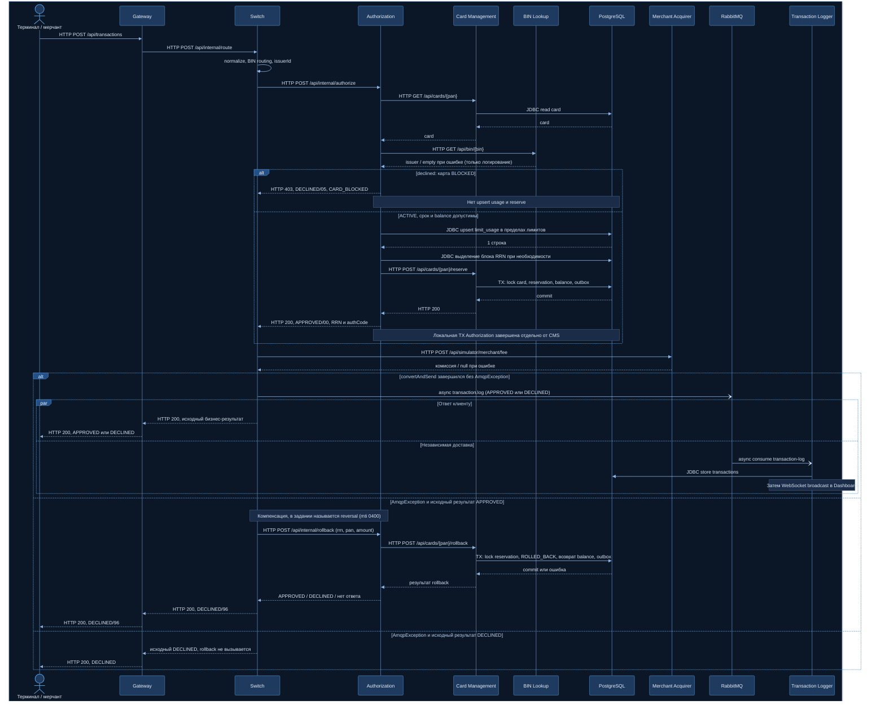

# А4. Sequence — путь транзакции

> Порядок вызовов одной авторизации (MTI 0100 → 0110) в трёх сценариях: **happy path**,
> **declined** (карта BLOCKED) и **reversal / компенсация** (публикация в RabbitMQ не удалась
> после APPROVED). Видно, где вызов синхронный, а где асинхронная «вилка» после ответа клиенту.
> Источник истины — [`RouteService.route()`](../../../services/switch/src/main/java/com/processing/service/RouteService.java#L55)
> и [`AuthServiceImpl.authorize()`](../../../services/authorization/src/main/java/com/processing/authorization/services/AuthServiceImpl.java#L43).

Легенда: `->>` — синхронный вызов (ждём ответ), `-->>` — ответ, `-)` — асинхронная отправка
без ожидания обработки, блок `par` — действия, идущие параллельно и независимо.

## Описание

### Общая синхронная часть

1. Клиент (Terminal Simulator или Merchant Acquirer) отправляет `POST /api/transactions` на Gateway.
   Gateway валидирует поля (`TransactionValidationFilter`) и переписывает путь в `/api/internal/route` Switch.
2. Switch нормализует запрос и по первым 6 цифрам PAN находит `issuerId` в своей таблице BIN
   (`RoutingService`). Неизвестный BIN сразу даёт `DECLINED/14` без вызова Authorization (на диаграмме не показано).
3. Switch вызывает `POST /api/internal/authorize` (retry + circuit breaker). Если Authorization
   недоступен, клиент получает `DECLINED/05 "Authorization service unavailable"` (на диаграмме не показано).
4. Authorization **сначала** получает карту из CMS, **потом** обращается к BIN Lookup. Ответ BIN Lookup
   только логируется: на решение он не влияет, ошибка не прерывает авторизацию.

### Сценарий 1 — happy path

5. Карта ACTIVE, срок не истёк, `amount ≤ availableBalance`.
6. Authorization одним SQL-запросом (`INSERT … ON CONFLICT DO UPDATE … WHERE`) проверяет и накапливает
   дневной и месячный usage. 1 строка — лимиты соблюдены.
7. Генерируется RRN (при исчерпании блока — `fetchRrnBlock()` из `rrn_seq`).
8. `POST /api/cards/{pan}/reserve`: CMS в одной транзакции блокирует карту, создаёт резерв, уменьшает
   баланс и пишет событие в `outbox_event`.
9. Authorization возвращает `HTTP 200, APPROVED/00` с RRN и authCode. Его локальная транзакция
   (usage) коммитится отдельно от транзакции CMS — это две разные БД-транзакции в разных сервисах.

### Сценарий 2 — declined (карта BLOCKED)

5'. Статус карты BLOCKED → `DeclineOutcome.CARD_BLOCKED` → `HTTP 403`, тело `DECLINED/05`.
   Проверки срока, баланса и лимитов **не выполняются**: usage не меняется, reserve не вызывается.
   Switch не считает 403 ошибкой (`onStatus` с пустым обработчиком) и разбирает тело как обычный ответ.

### Общий хвост для сценариев 1 и 2

10. Switch запрашивает комиссию у Merchant Acquirer; при ошибке — `null`, обработка продолжается.
11. Switch публикует `TransactionRequest` (с итоговым статусом APPROVED или DECLINED) в
    `smp.transactions` / `transaction.log`.
12. **Асинхронная «вилка»** (`par`): клиент получает ответ сразу после публикации, а Logger потребляет
    сообщение и пишет строку в `transactions` позже и независимо, затем рассылает её в Dashboard
    по WebSocket. Поэтому в момент ответа записи в журнале может ещё не быть — E2E-тест должен ждать
    её polling'ом, а не проверять мгновенно.
    Switch всегда отвечает Gateway `HTTP 200`; бизнес-результат — в теле.

### Сценарий 3 — reversal / компенсация

13. Если `LoggerClient.log()` вернул `false` (при `convertAndSend` возникло `AmqpException`), а исход
    авторизации был APPROVED, Switch откатывает резерв: `POST /api/internal/rollback` с телом
    `{rrn, pan, amount}` → Authorization → `POST /api/cards/{pan}/rollback`.
14. CMS в транзакции блокирует резерв, переводит его в `ROLLED_BACK`, возвращает деньги на баланс,
    пишет outbox-событие. Повторный rollback того же резерва отклоняется.
15. Независимо от результата отката (успех, отказ или нет ответа — результат только логируется)
    клиент получает `HTTP 200, DECLINED/96 "System error"`. В журнал Logger эта транзакция не попадает:
    публикация как раз и не удалась.
16. Если публикация не удалась, а исход был DECLINED, откатывать нечего: клиент получает исходный DECLINED.

### Расхождение задания и кода (reversal)

| Задание / документация | Код |
|---|---|
| Reversal запускается, если Switch **не получил publisher confirm за 2 секунды** | Ожидания confirm нет: `publisher-confirm-type: correlated` включён, но `ConfirmCallback`, `CorrelationData` и ожидания в коде нет. Триггер — только исключение при `convertAndSend` |
| Сообщение reversal с **MTI 0400** | `RollbackRequest` содержит только `rrn`, `pan`, `amount`; поля MTI нет — семантически это reversal, но не сообщение 0400 |

Поэтому на диаграмме ветки подписаны по фактическому коду (`AmqpException`), а термин «reversal 0400»
оставлен в заметке. Несоответствие проверяется тест-кейсом N16.

## Чего не хватало в проекте

Sequence в [`docs/architecture.md`](../../architecture.md) описывает по сути только happy path:
- ветка `declined` обобщённая — без причины, кода и HTTP-статуса, без указания, какие шаги пропускаются;
- **нет reversal**: публикация в RabbitMQ нарисована безусловной, отката резерва нет вообще;
- порядок вызовов расходится с кодом: BIN Lookup вызывается **до** получения карты, RRN генерируется
  **после** reserve, нет вызова Merchant Acquirer за комиссией;
- публикация события CMS нарисована как прямой вызов из reserve, а в коде это outbox + планировщик;
- не показана асинхронная «вилка»: ответ клиенту и запись в журнал идут последовательно.

## Что сделано

- Порядок вызовов восстановлен по коду `RouteService` и `AuthServiceImpl`.
- Три сценария сведены в одну диаграмму через `alt`: BLOCKED, APPROVED и две ветки отказа публикации.
- Асинхронная часть выделена через `-)` и `par`: ответ клиенту и запись в журнал независимы.
- Расхождения «2 секунды confirm» и «MTI 0400» с кодом зафиксированы явно.

## Для чего нужно в тестировании

- Синхронная цепочка (до ответа клиенту) — контракты для API-тестов каждого звена.
- `par`-блок — причина, по которой E2E и integration-тесты журнала ждут результат polling'ом.
- Ветка reversal — ценный integration-сценарий с fault injection в RabbitMQ (N04 на unit, N16 на integration).
- Declined — пример проверки «отказ без побочных эффектов» (N02, N20).

## Источники истины

| Шаг | Код |
|---|---|
| Gateway: `/api/transactions` → `/api/internal/route` | [`gateway application.yml#L64`](../../../services/gateway/src/main/resources/application.yml#L64) |
| Switch: вход, всегда HTTP 200 | [`RouteController.java#L44`](../../../services/switch/src/main/java/com/processing/controller/RouteController.java#L44), [`#L49`](../../../services/switch/src/main/java/com/processing/controller/RouteController.java#L49) |
| Нормализация и BIN-маршрутизация | [`RouteService.java#L60`](../../../services/switch/src/main/java/com/processing/service/RouteService.java#L60), [`#L67`](../../../services/switch/src/main/java/com/processing/service/RouteService.java#L67), [`RoutingService.java`](../../../services/switch/src/main/java/com/processing/service/RoutingService.java) |
| Switch → Authorization, не-2xx разбирается | [`RouteService.java#L69`](../../../services/switch/src/main/java/com/processing/service/RouteService.java#L69), [`AuthorizationClient.java#L81`](../../../services/switch/src/main/java/com/processing/service/AuthorizationClient.java#L81) |
| GET карты, затем BIN Lookup | [`AuthServiceImpl.java#L46`](../../../services/authorization/src/main/java/com/processing/authorization/services/AuthServiceImpl.java#L46), [`#L66`](../../../services/authorization/src/main/java/com/processing/authorization/services/AuthServiceImpl.java#L66) |
| BLOCKED → CARD_BLOCKED/05 → HTTP 403 | [`AuthServiceImpl.java#L85`](../../../services/authorization/src/main/java/com/processing/authorization/services/AuthServiceImpl.java#L85), [`DeclineOutcome.java`](../../../services/authorization/src/main/java/com/processing/authorization/constants/DeclineOutcome.java), [`AuthControllerImpl.java#L82`](../../../services/authorization/src/main/java/com/processing/authorization/controller/AuthControllerImpl.java#L82) |
| Лимиты, RRN, reserve | [`AuthServiceImpl.java#L125`](../../../services/authorization/src/main/java/com/processing/authorization/services/AuthServiceImpl.java#L125), [`#L149`](../../../services/authorization/src/main/java/com/processing/authorization/services/AuthServiceImpl.java#L149), [`#L151`](../../../services/authorization/src/main/java/com/processing/authorization/services/AuthServiceImpl.java#L151), [`#L197`](../../../services/authorization/src/main/java/com/processing/authorization/services/AuthServiceImpl.java#L197) |
| Reserve в CMS: блокировка, резерв, outbox в одной TX | [`CardServiceImpl.java#L198`](../../../services/card-management/src/main/java/com/processing/cardmanagement/services/CardServiceImpl.java#L198), [`TransactionRunnerImpl.java#L11`](../../../services/card-management/src/main/java/com/processing/cardmanagement/services/TransactionRunnerImpl.java#L11) |
| Комиссия, `null` при ошибке | [`RouteService.java#L70`](../../../services/switch/src/main/java/com/processing/service/RouteService.java#L70), [`MerchantAcquirerClient.java#L59`](../../../services/switch/src/main/java/com/processing/service/MerchantAcquirerClient.java#L59) |
| Публикация и `false` при `AmqpException` | [`RouteService.java#L85`](../../../services/switch/src/main/java/com/processing/service/RouteService.java#L85), [`LoggerClient.java#L40`](../../../services/switch/src/main/java/com/processing/service/LoggerClient.java#L40), [`#L47`](../../../services/switch/src/main/java/com/processing/service/LoggerClient.java#L47) |
| Confirm включён, но не ожидается | [`switch application.yml#L10`](../../../services/switch/src/main/resources/application.yml#L10) |
| Условие компенсации и ответ 96 | [`RouteService.java#L87`](../../../services/switch/src/main/java/com/processing/service/RouteService.java#L87), [`#L89`](../../../services/switch/src/main/java/com/processing/service/RouteService.java#L89), [`#L91`](../../../services/switch/src/main/java/com/processing/service/RouteService.java#L91) |
| Тело rollback без MTI | [`AuthorizationClient.java#L100`](../../../services/switch/src/main/java/com/processing/service/AuthorizationClient.java#L100), [`RollbackRequest.java#L12`](../../../services/common/src/main/java/com/processing/common/dto/authorization/RollbackRequest.java#L12) |
| Rollback в Authorization и CMS | [`AuthServiceImpl.java#L223`](../../../services/authorization/src/main/java/com/processing/authorization/services/AuthServiceImpl.java#L223), [`CardServiceImpl.java#L213`](../../../services/card-management/src/main/java/com/processing/cardmanagement/services/CardServiceImpl.java#L213), [`Reservation.java#L50`](../../../services/card-management/src/main/java/com/processing/cardmanagement/models/Reservation.java#L50) |
| Logger: потребление, сохранение, WebSocket | [`TransactionLogListener.java#L27`](../../../services/transaction-logger/src/main/java/com/processing/transactionlogger/listener/TransactionLogListener.java#L27), [`TransactionService.java#L71`](../../../services/transaction-logger/src/main/java/com/processing/transactionlogger/service/TransactionService.java#L71) |
