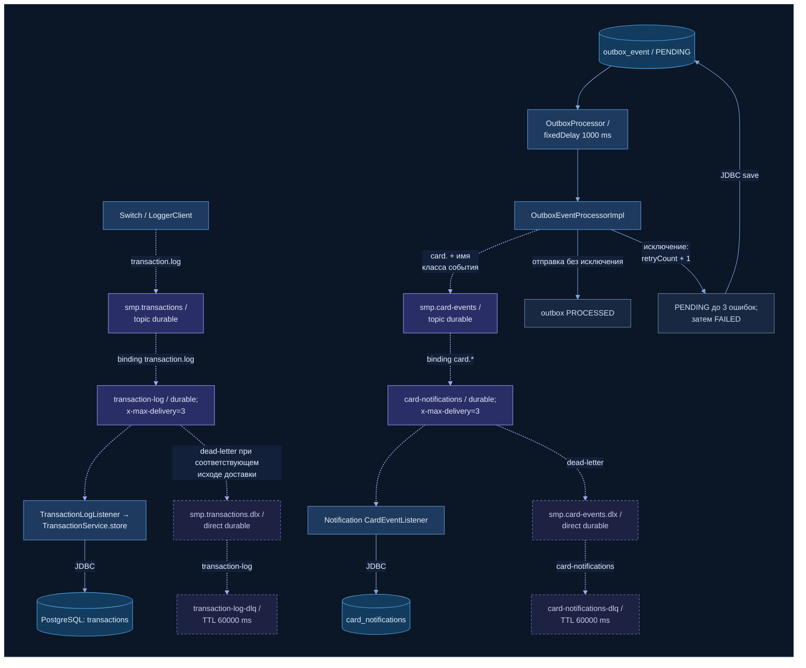

# А5. RabbitMQ-топология

> Точная карта асинхронных путей: exchange → binding → queue → consumer, DLX/DLQ, outbox на стороне
> отправителя, publisher confirms, retry и TTL.
> Источник истины — классы `RabbitMQConfig` четырёх сервисов, `LoggerClient`, outbox-компоненты CMS и `application.*`.

Легенда: пунктир — движение сообщения через брокер (AMQP); сплошная линия — синхронная работа
внутри сервиса или JDBC.

## Описание

### Путь A: Switch → Transaction Logger

| Элемент | Значение | Кто объявляет |
|---|---|---|
| Exchange | `smp.transactions`, `topic`, durable | Switch и Logger |
| Routing key / binding | `transaction.log` | Switch и Logger |
| Очередь | `transaction-log`, durable; `x-dead-letter-exchange=smp.transactions.dlx`, `x-dead-letter-routing-key=transaction-log`, `x-max-delivery=3` | Switch и Logger (аргументы совпадают) |
| DLX | `smp.transactions.dlx`, `direct`, durable | только Switch |
| DLQ | `transaction-log-dlq`, `x-message-ttl=60000` | только Switch |
| Consumer | `TransactionLogListener` → `TransactionService.store()`: сохраняет строку в `transactions`; повтор с тем же `id` не создаёт дубль | Logger |

Сообщение — `TransactionRequest` (JSON) с итоговым статусом APPROVED/DECLINED; публикуется синхронно
внутри `RouteService.route()` до ответа клиенту, а обрабатывается асинхронно.

### Путь C: Card Management (outbox) → Notification Service

1. **Запись в outbox.** Изменяющая операция CMS (создание, PATCH, удаление, reserve, rollback, генерация)
   в той же БД-транзакции сохраняет событие в `outbox_event` со статусом `PENDING`.
2. **Планировщик.** `OutboxProcessor` раз в 1000 ms (`fixedDelay`, `app.outbox.interval-ms`) выбирает
   события `PENDING` с `retryCount < 3`.
3. **Публикация.** `OutboxEventProcessorImpl` отправляет событие в `smp.card-events` (topic) с routing key
   `card.<ИмяКлассаСобытия>`, например `card.CardServicePatchEvent`.
   - без исключения → `PROCESSED`;
   - исключение → `retryCount + 1`, `lastError`; на 3-й ошибке → `FAILED` (больше не выбирается).
4. **Маршрутизация.** Binding `card.*` доставляет событие в `card-notifications`.
5. **Потребление.** `CardEventListener` получает сырой JSON, проверяет его парсингом, берёт тип события из
   routing key и сохраняет в `card_notifications`. При любой ошибке бросает исключение.
6. **Dead letter.** У `card-notifications` настроены `smp.card-events.dlx` (direct) →
   `card-notifications-dlq` с TTL 60 s. Объявляют и CMS, и Notification с одинаковыми аргументами.

### Механика надёжности: что требует задание и что есть в коде

| Механизм | Требование задания / документации | Фактическая реализация |
|---|---|---|
| Outbox | — | Есть: атомарная запись события с бизнес-изменением + планировщик + 3 попытки отправки → FAILED. Это retry **на стороне отправителя** |
| Publisher confirms, 2 s | Switch ждёт подтверждение брокера до 2 s, без него — reversal | `publisher-confirm-type: correlated` включён в Switch и CMS, но в коде нет `ConfirmCallback`, `CorrelationData` и ожидания. `LoggerClient` возвращает `true` сразу после `convertAndSend`; `false` — только при `AmqpException`. Значение 2000 ms есть лишь в `switch.http.logger-read-timeout-ms`, и оно нигде не используется. → проверяется N16 |
| Consumer retry, 3 попытки | Сообщение возвращается в очередь до 3 раз, затем в DLQ | Очереди объявлены с `x-max-delivery=3`, но такого аргумента у RabbitMQ нет (для quorum-очередей это `x-delivery-limit`), а retry listener'а (`RetryInterceptor`, `default-requeue-rejected`) не настроен. Фактическое поведение определяется дефолтами Spring AMQP. Поэтому на диаграмме переход в DLX подписан осторожно: «при соответствующем исходе доставки». → проверяется N14 |
| TTL 60 s в DLQ | Сообщения в DLQ живут 60 s | Есть: `x-message-ttl=60000` у обеих DLQ. Проверяется N15 |

## Чего не хватало в проекте

- В [`docs/architecture.md`](../../architecture.md) топология дана **таблицей и текстом**, диаграммы нет:
  не видно пути сообщения и места отказа.
- Текст документации расходится с кодом: описан `ConfirmCallback` с `CorrelationData` и таймаутом 2 s,
  которых в коде нет; для outbox заявлен «exponential backoff», а в коде фиксированный интервал 1000 ms.
- Не указано, кто объявляет DLX/DLQ: для `transaction-log-dlq` это только Switch.
- Outbox показан как прямая публикация, без статусов `PENDING → PROCESSED / FAILED`.

## Что сделано

- Оба пути визуализированы целиком: producer → exchange → binding → queue → consumer → таблица БД.
- Для каждой очереди показаны DLX, DLQ и TTL; для outbox — жизненный цикл записи и предел 3 ошибок.
- Требования задания (confirms 2 s, retry 3, TTL 60 s) сопоставлены с кодом; расхождения отмечены
  ссылками на тест-кейсы.

## Для чего нужно в тестировании

Карта для integration-тестов с брокером (модуль 6): где проверять доставку (строка в `transactions`,
запись в `card_notifications`), где идемпотентность (повтор того же `id` в Logger), где retry
(outbox `retryCount`, FAILED), где DLQ и TTL. Все такие проверки ждут результат polling'ом —
это eventual consistency.

## Источники истины

| Утверждение | Код / конфигурация |
|---|---|
| Топология транзакций: exchange, queue, аргументы, DLX/DLQ, TTL | [switch `RabbitMQConfig.java#L22`](../../../services/switch/src/main/java/com/processing/config/RabbitMQConfig.java#L22), [`#L47`](../../../services/switch/src/main/java/com/processing/config/RabbitMQConfig.java#L47), [`#L58`](../../../services/switch/src/main/java/com/processing/config/RabbitMQConfig.java#L58), [`#L75`](../../../services/switch/src/main/java/com/processing/config/RabbitMQConfig.java#L75) |
| Logger объявляет только основную очередь | [transaction-logger `RabbitMQConfig.java#L45`](../../../services/transaction-logger/src/main/java/com/processing/transactionlogger/config/RabbitMQConfig.java#L45) |
| Публикация Switch, `false` только при `AmqpException` | [`LoggerClient.java#L40`](../../../services/switch/src/main/java/com/processing/service/LoggerClient.java#L40), [`#L47`](../../../services/switch/src/main/java/com/processing/service/LoggerClient.java#L47) |
| Confirms включены, 2000 ms не используется | [switch `application.yml#L10`](../../../services/switch/src/main/resources/application.yml#L10), [`#L22`](../../../services/switch/src/main/resources/application.yml#L22); CMS [`application.properties#L74`](../../../services/card-management/src/main/resources/application.properties#L74) |
| Consumer Logger и идемпотентность по `id` | [`TransactionLogListener.java#L27`](../../../services/transaction-logger/src/main/java/com/processing/transactionlogger/listener/TransactionLogListener.java#L27), [`TransactionService.java#L72`](../../../services/transaction-logger/src/main/java/com/processing/transactionlogger/service/TransactionService.java#L72) |
| Топология карточных событий | [card-management `RabbitMQConfig.java#L27`](../../../services/card-management/src/main/java/com/processing/cardmanagement/config/RabbitMQConfig.java#L27), [`#L64`](../../../services/card-management/src/main/java/com/processing/cardmanagement/config/RabbitMQConfig.java#L64), [`#L90`](../../../services/card-management/src/main/java/com/processing/cardmanagement/config/RabbitMQConfig.java#L90); [notification `RabbitMQConfig.java#L52`](../../../services/notification-service/src/main/java/com/processing/notification/config/RabbitMQConfig.java#L52), [`#L62`](../../../services/notification-service/src/main/java/com/processing/notification/config/RabbitMQConfig.java#L62), [`#L73`](../../../services/notification-service/src/main/java/com/processing/notification/config/RabbitMQConfig.java#L73) |
| Запись события в outbox | [`CardEventNotifierImpl.java#L17`](../../../services/card-management/src/main/java/com/processing/cardmanagement/events/CardEventNotifierImpl.java#L17) |
| Планировщик и выборка PENDING с `retryCount < 3` | [`OutboxProcessor.java#L21`](../../../services/card-management/src/main/java/com/processing/cardmanagement/services/OutboxProcessor.java#L21), [`#L24`](../../../services/card-management/src/main/java/com/processing/cardmanagement/services/OutboxProcessor.java#L24), [`OutboxJpaAdapter.java#L35`](../../../services/card-management/src/main/java/com/processing/cardmanagement/repositories/OutboxJpaAdapter.java#L35), [`application.properties#L66`](../../../services/card-management/src/main/resources/application.properties#L66) |
| Публикация, PROCESSED, retry → FAILED | [`OutboxEventProcessorImpl.java#L35`](../../../services/card-management/src/main/java/com/processing/cardmanagement/services/OutboxEventProcessorImpl.java#L35), [`#L40`](../../../services/card-management/src/main/java/com/processing/cardmanagement/services/OutboxEventProcessorImpl.java#L40), [`#L50`](../../../services/card-management/src/main/java/com/processing/cardmanagement/services/OutboxEventProcessorImpl.java#L50), [`CardOutboxEventData.java#L70`](../../../services/card-management/src/main/java/com/processing/cardmanagement/models/CardOutboxEventData.java#L70) |
| Consumer Notification | [`CardEventListener.java#L36`](../../../services/notification-service/src/main/java/com/processing/notification/listener/CardEventListener.java#L36), [`CardNotification.java#L25`](../../../services/notification-service/src/main/java/com/processing/notification/model/CardNotification.java#L25) |
| Описание в документации (для сравнения) | [`docs/architecture.md`](../../architecture.md) — раздел «Асинхронное взаимодействие (RabbitMQ)» |
