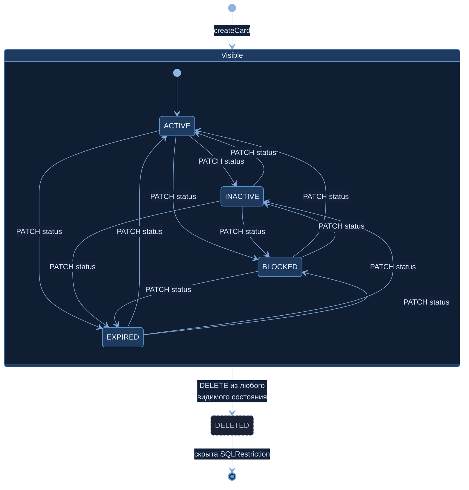
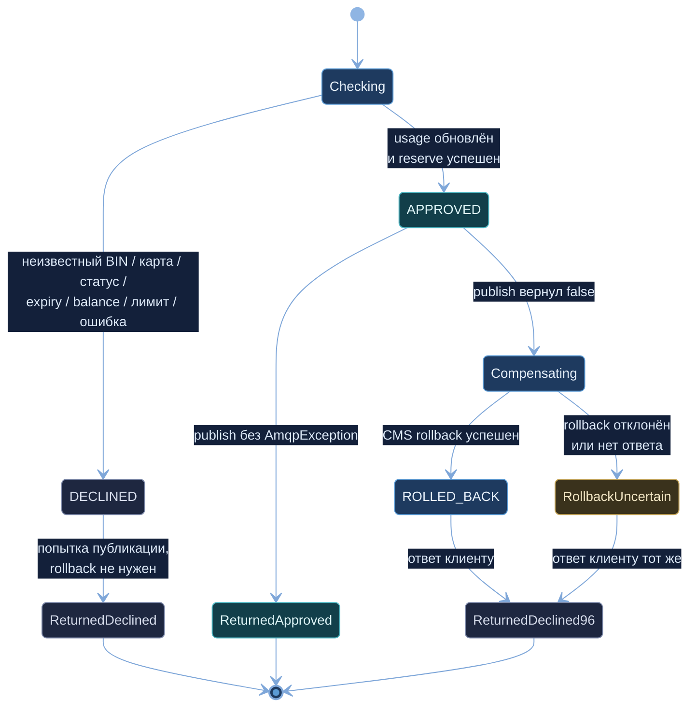

# А6. State-transition — Card.status и жизненный цикл транзакции

> Две диаграммы состояний: статус карты в Card Management и путь одной транзакции от проверки до
> ответа клиенту (APPROVED / DECLINED / ROLLED_BACK через компенсацию).
> Источник истины — enum [`CardStatus`](../../../services/card-management/src/main/java/com/processing/cardmanagement/models/CardStatus.java),
> [`CardServiceImpl`](../../../services/card-management/src/main/java/com/processing/cardmanagement/services/CardServiceImpl.java),
> [`AuthServiceImpl.authorize()`](../../../services/authorization/src/main/java/com/processing/authorization/services/AuthServiceImpl.java#L43)
> и [`RouteService.route()`](../../../services/switch/src/main/java/com/processing/service/RouteService.java#L55).

## Диаграмма 1. Card.status

### Описание

**Состояния.** В домене CMS пять значений `CardStatus`: `ACTIVE`, `INACTIVE`, `BLOCKED`, `EXPIRED`
и служебный `DELETED`. Наружу (DTO `CardModelStatus`) отдаются только первые четыре — они собраны
в составное состояние `Visible`. `DELETED` через API не выставить и не прочитать.

**Начальное состояние.** `POST /api/cards` всегда создаёт карту в `ACTIVE`.

**Переходы внутри Visible.** `PATCH /api/cards/{pan}` с полем `status` записывает новый статус без
какой-либо проверки допустимости перехода, поэтому граф полный: из любого видимого статуса можно
перейти в любой другой (12 переходов на диаграмме). PATCH с тем же статусом тоже допустим и тоже
создаёт outbox-событие `CardServicePatchEvent` (петли на диаграмме не показаны).

**Удаление.** `DELETE /api/cards/{pan}` — soft delete: статус меняется на `DELETED`, строка остаётся в
БД. `@SQLRestriction("status <> 'DELETED'")` скрывает такие карты из всех запросов, поэтому дальше
GET, PATCH, reserve и повторный DELETE дают 404, а авторизация — `DECLINED/14`. Переход необратим.

**Что статус значит для процессинга.**

| Статус | Authorization | Reserve в CMS |
|---|---|---|
| ACTIVE | продолжает проверки (срок, баланс, лимиты) | разрешён |
| INACTIVE | `DECLINED/05`, `CARD_INACTIVE`, HTTP 403 | запрещён (`checkStatusOrThrow`) |
| BLOCKED | `DECLINED/05`, `CARD_BLOCKED`, HTTP 403 | запрещён |
| EXPIRED | `DECLINED/54`, `CARD_EXPIRED`, HTTP 403 | запрещён |
| DELETED | карта не найдена → `DECLINED/14`, HTTP 404 | 404 |

**Важно: `EXPIRED` не наступает сам.** В коде нет планировщика, переводящего карту в `EXPIRED` по дате.
Истечение срока проверяется отдельно, при каждой авторизации (`expiryDate` конец месяца vs UTC-дата
запроса → `DECLINED/54`), а статус карты при этом остаётся `ACTIVE`. Поэтому на диаграмме все переходы
в `EXPIRED` — только ручные.

**Чего нет на диаграмме, но есть в коде** (дополнительные источники переходов):
- `POST /api/cards/bulk-update` меняет статус сразу у списка карт (по BIN или PAN) с той же свободой
  переходов, но, в отличие от PATCH, **не создаёт outbox-событие** — Notification об этом не узнает;
- `POST /api/cards/generate` создаёт карты не только в `ACTIVE`: ~95 % ACTIVE, ~3 % INACTIVE,
  остальные BLOCKED. То есть начальным может быть любой из этих трёх статусов.

## Диаграмма 2. Жизненный цикл транзакции

### Описание

У транзакции нет одной сущности со статусом на всём пути: состояние складывается из решения
Authorization, результата публикации в Switch и статуса резерва в CMS. Диаграмма собирает это
в один автомат.

| Состояние | Где живёт в коде | Смысл |
|---|---|---|
| `Checking` | `RouteService.route()` + `AuthServiceImpl.authorize()` | BIN-маршрутизация в Switch, затем проверки Authorization в фиксированном порядке |
| `DECLINED` | `AuthorizationResponse.status = DECLINED` | Отказ: неизвестный BIN (14, решает Switch), Authorization недоступен (05, решает Switch), карта не найдена (14), статус (05), срок (54), баланс (51), лимит (61), сбой CMS/БД (96) |
| `APPROVED` | `AuthorizationResponse.status = APPROVED`; в CMS резерв `RESERVED` | Usage в `limit_usage` увеличен, деньги зарезервированы |
| `Compensating` | ветка `!logged && APPROVED` в `RouteService` | Публикация в RabbitMQ не удалась — нужно вернуть деньги |
| `ROLLED_BACK` | `Reservation.status = ROLLED_BACK` в CMS | Резерв отменён, баланс восстановлен |
| `RollbackUncertain` | rollback вернул DECLINED (уже отменён, CMS недоступна) или `null` | Результат только логируется; резерв может остаться `RESERVED` — деньги «зависают» |
| `ReturnedApproved` | ответ `APPROVED/00` | Запись APPROVED появится в журнале асинхронно |
| `ReturnedDeclined` | ответ с исходным кодом отказа | Запись DECLINED появится в журнале асинхронно (если публикация прошла) |
| `ReturnedDeclined96` | `AuthorizationResponse.systemError` → `DECLINED/96` | Клиент получает одинаковый ответ при успешном и неуспешном откате; в журнал транзакция не попадает |

**Где в коде `ROLLED_BACK`.** В журнале Logger (`TransactionStatus`) есть только `APPROVED` и `DECLINED`.
Статус `ROLLED_BACK` существует только у резерва в CMS (`ReservationStatus`: `RESERVED → ROLLED_BACK`),
повторный откат запрещён (`RollbackAlreadySatisfiedException`). Поэтому `ROLLED_BACK` на диаграмме —
состояние денег по транзакции, а не строка журнала.

**Триггер компенсации.** По заданию — отсутствие publisher confirm за 2 s; по коду — `AmqpException`
при отправке (см. [А4](a4-sequence.md#расхождение-задания-и-кода-reversal)). Диаграмма подписана по коду.

## Чего не хватало в проекте

- State-диаграмм нет ни в [`docs/architecture.md`](../../architecture.md), ни в puml.
  Статус карты описан только перечислением в разделе «Модель данных».
- Нигде не зафиксировано, что переходы статусов не валидируются, что `EXPIRED` не выставляется
  автоматически и что удаление — soft delete со скрытием через `@SQLRestriction`.
- Жизненный цикл транзакции с компенсацией и состоянием «откат не подтверждён» не описан.

## Что сделано

- Диаграмма статуса карты собрана из `CardStatus`, `CardServiceImpl` (`createCard`, `patchCard`,
  `deleteCard`) и `CardEntity`; внешние и служебный статусы разделены.
- Для каждого статуса указано, как на него реагируют Authorization и reserve.
- Диаграмма транзакции связывает решения трёх сервисов (Switch, Authorization, CMS) в один автомат,
  включая неопределённый исход отката.

## Для чего нужно в тестировании

Каждый переход — отдельный тест-кейс (техника state-transition, модуль 2):
- переходы карты → API/integration-тесты PATCH и DELETE (сохранение, скрытие, 404);
- переход «статус → решение авторизации» → unit `authorize()` (N02) и сквозной сценарий
  «заблокировали карту → транзакция отклонена» (N20);
- `RESERVED → ROLLED_BACK` и повторный откат → integration (N18);
- `APPROVED → Compensating` → unit (N04) и integration с отказом брокера (N16);
- `RollbackUncertain` — риск «зависших» денег, кандидат на отдельную негативную проверку.

## Источники истины

| Утверждение | Код |
|---|---|
| Значения статусов (домен / DTO) | [`CardStatus.java`](../../../services/card-management/src/main/java/com/processing/cardmanagement/models/CardStatus.java), [`CardModelStatus.java`](../../../services/common/src/main/java/com/processing/common/dto/cardmanagement/CardModelStatus.java) |
| `DELETED` наружу не отдаётся | [`CardStatusMapper.java#L12`](../../../services/card-management/src/main/java/com/processing/cardmanagement/mappers/CardStatusMapper.java#L12), [`PatchCardRequest.java#L23`](../../../services/common/src/main/java/com/processing/common/dto/cardmanagement/PatchCardRequest.java#L23) |
| Создание всегда ACTIVE | [`CardServiceImpl.java#L50`](../../../services/card-management/src/main/java/com/processing/cardmanagement/services/CardServiceImpl.java#L50) |
| PATCH без проверки перехода | [`CardServiceImpl.java#L143`](../../../services/card-management/src/main/java/com/processing/cardmanagement/services/CardServiceImpl.java#L143), [`CardController.java#L176`](../../../services/card-management/src/main/java/com/processing/cardmanagement/controllers/CardController.java#L176) |
| Soft delete и скрытие | [`CardServiceImpl.java#L166`](../../../services/card-management/src/main/java/com/processing/cardmanagement/services/CardServiceImpl.java#L166), [`Card.java#L168`](../../../services/card-management/src/main/java/com/processing/cardmanagement/models/Card.java#L168), [`CardEntity.java#L22`](../../../services/card-management/src/main/java/com/processing/cardmanagement/models/CardEntity.java#L22) |
| Bulk-update без события | [`CardServiceImpl.java#L230`](../../../services/card-management/src/main/java/com/processing/cardmanagement/services/CardServiceImpl.java#L230), [`CardController.java#L256`](../../../services/card-management/src/main/java/com/processing/cardmanagement/controllers/CardController.java#L256) |
| Генерация карт в разных статусах | [`CardGeneratorService.java#L99`](../../../services/card-management/src/main/java/com/processing/cardmanagement/services/CardGeneratorService.java#L99) |
| Reserve только для ACTIVE | [`Card.java#L102`](../../../services/card-management/src/main/java/com/processing/cardmanagement/models/Card.java#L102), [`#L261`](../../../services/card-management/src/main/java/com/processing/cardmanagement/models/Card.java#L261) |
| Реакция Authorization на статус и срок | [`AuthServiceImpl.java#L85`](../../../services/authorization/src/main/java/com/processing/authorization/services/AuthServiceImpl.java#L85), [`#L107`](../../../services/authorization/src/main/java/com/processing/authorization/services/AuthServiceImpl.java#L107), [`DeclineOutcome.java`](../../../services/authorization/src/main/java/com/processing/authorization/constants/DeclineOutcome.java), [`AuthControllerImpl.java#L82`](../../../services/authorization/src/main/java/com/processing/authorization/controller/AuthControllerImpl.java#L82) |
| Отказы на уровне Switch (14, 05) | [`RouteService.java#L67`](../../../services/switch/src/main/java/com/processing/service/RouteService.java#L67), [`AuthorizationResponse.java#L50`](../../../services/common/src/main/java/com/processing/common/dto/authorization/AuthorizationResponse.java#L50) |
| Компенсация и ответ 96 | [`RouteService.java#L87`](../../../services/switch/src/main/java/com/processing/service/RouteService.java#L87), [`#L91`](../../../services/switch/src/main/java/com/processing/service/RouteService.java#L91) |
| `ReservationStatus` и запрет повторного отката | [`ReservationStatus.java`](../../../services/card-management/src/main/java/com/processing/cardmanagement/models/ReservationStatus.java), [`Reservation.java#L50`](../../../services/card-management/src/main/java/com/processing/cardmanagement/models/Reservation.java#L50) |
| Статусы журнала: только APPROVED / DECLINED | [`TransactionStatus.java#L8`](../../../services/common/src/main/java/com/processing/common/dto/transactionlogger/TransactionStatus.java#L8) |
